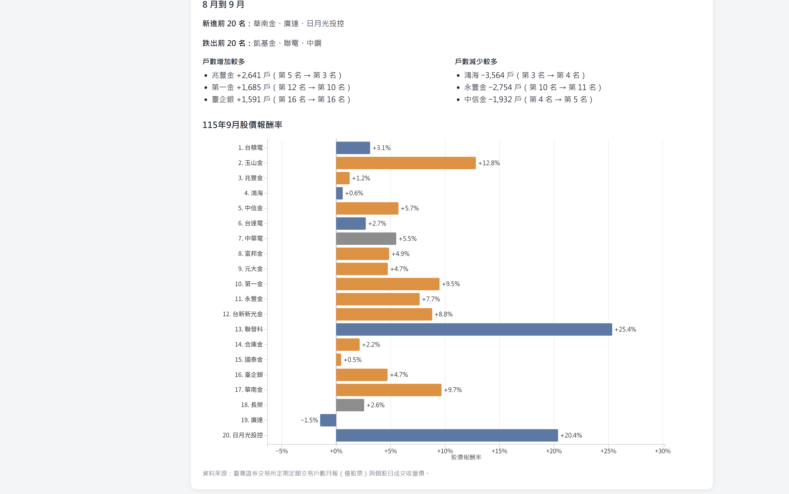

# 1151VIS-HW2-414085179-HsiehYuanChang

資料視覺化 HW2：延續作業一，改成可互動的 D3.js 長條圖

- 學號：414085179
- 姓名：謝源璋
- GitHub：https://github.com/acsdqscv951478/1151VIS-HW2-414085179-HsiehYuanChang
- YouTube：https://youtu.be/Zl-nBx42poU

## 專案截圖





## 研究問題

戶數是集中在少數股票，還是散在各產業？同一個月份裡，戶數高的股票，股價報酬率也比較高嗎？

## 資料來源與整理

臺灣證券交易所「定期定額交易戶數統計排行月報表」。

- 115 年 8 月：與作業一相同
- 115 年 9 月：證交所開放資料（https://www.twse.com.tw/zh/ETFReport/ETFRank?response=open_data）

原始報表同時有股票和 ETF。這次一樣只留股票，去掉千分位逗號，並沿用作業一的產業分類（電子、金融、其他），存成 `public/data/stocks.csv`。9 月新進的廣達、日月光投控歸在電子，華南金歸在金融。

股價取自證交所個股日成交資訊的收盤價。8 月報酬率是 115 年 7 月 31 日收盤到 8 月 31 日收盤，9 月報酬率是 8 月 31 日收盤到 9 月 30 日收盤，不含現金股利。

## 圖表與操作

網頁上有兩張水平長條圖，顏色都是電子（藍）、金融（橘）、其他（灰）。上面是交易戶數，下面是同一個月的股價報酬率，股票順序相同。報酬率圖以零為中線，右邊是上漲，左邊是下跌。

操作方式：

1. 切換 115 年 8 月、115 年 9 月，兩張圖會一起移動
2. 滑鼠移到長條上，可看戶數、占比、另一個月的排名，或報酬率的期初、期末收盤價
3. 點電子、金融、其他時，戶數圖的橫軸會依畫面上的最大值重算
4. 上方三個數字用該月完整的前 20 名計算，篩選產業或隱藏台積電不會改到它們
5. 右側產業長條依目前最長的產業縮放。隱藏台積電後，電子會縮短，金融變成最長
6. 戶數圖的淺色底標出該月前 5 名

## 從圖上看到的事

以 9 月完整前 20 名為例，上方數字會隨月份更新：

- 前 5 名合計約占前 20 名的 67.6%，戶數集中在前段
- 台積電單檔約占 48.5%。電子合計看起來最大，扣掉台積電之後，電子剩 57,674 戶，少於金融的 169,054 戶。檔數也是金融較多（12 檔）
- 8 月的形態差不多
- 新進前 20 名：華南金、廣達、日月光投控。跌出：凱基金、聯電、中鋼
- 戶數增加較多的是兆豐金、第一金、臺企銀；減少較多的是鴻海、永豐金、中信金
- 長榮排名從第 20 名升到第 18 名，戶數卻從 5,134 降到 4,977。名次往前，是因為有股票跌出前 20 名，不是扣款戶變多
- 9 月戶數第 1 的台積電，當月股價報酬率約 +3.1%；同月報酬率最高的是聯發科約 +25.4%，戶數只排第 13
- 8 月台積電戶數仍是第 1，當月股價約 -0.8%；同月報酬率最高的是長榮約 +14.5%，戶數排第 20


## 製作流程

1. 沿用作業一的 Vue 3 + Vite，建立作業二專案
2. 參考上份作業老師的建議多整理 9 月份的股票資料進來比對
3. 另外新增一張圖表用 7 月底、8 月底、9 月底收盤價計算當月股價報酬率，分析投資報酬率與定期定額數量的關係
4. 執行 `npm run dev` 確認互動，截圖並錄影

## 執行方式

```bash
npm install
npm run dev
```
