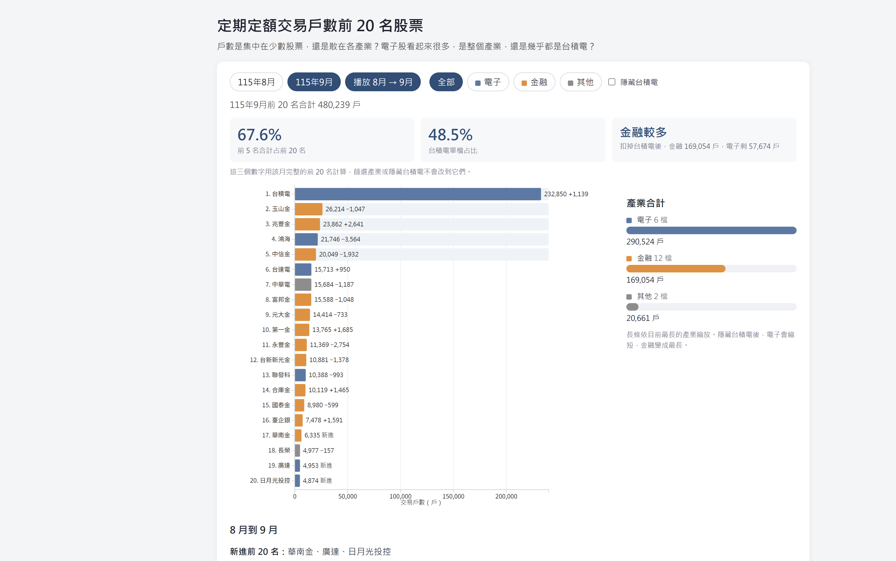
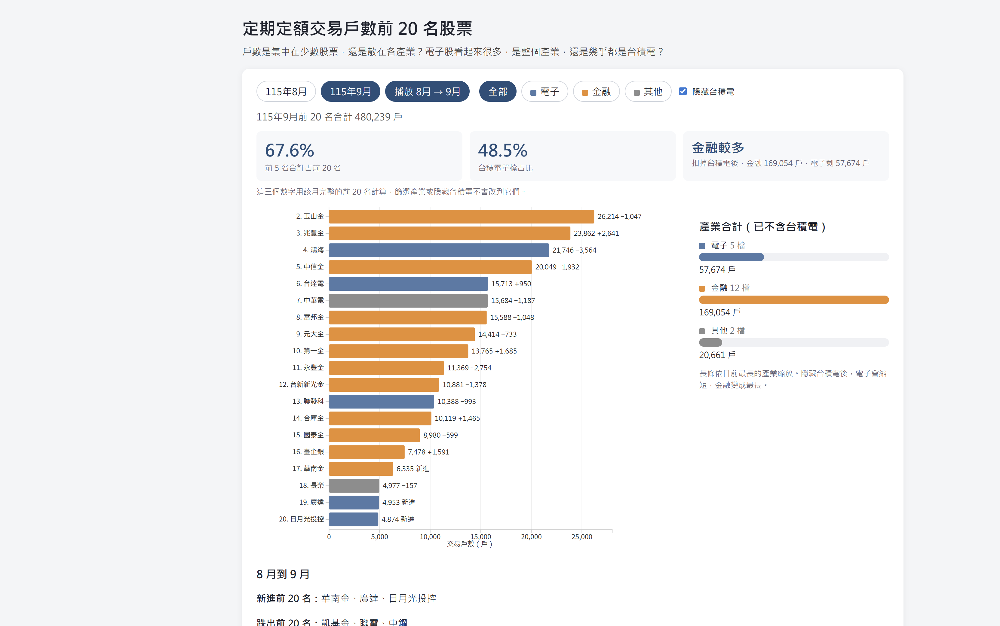

# 1151VIS-HW2-414085179-HsiehYuanChang

資料視覺化 HW2：延續作業一，改成可互動的 D3.js 長條圖

- 學號：414085179
- 姓名：謝源璋
- GitHub：https://github.com/acsdqscv951478/1151VIS-HW2-414085179-HsiehYuanChang
- YouTube：（錄好影片後，把連結貼在這裡）

## 專案截圖





## 研究問題

前 20 名股票的定期定額交易戶數，是集中在少數股票，還是平均散在各產業？電子類戶數很高，是整個電子業都很多人買，還是幾乎都來自台積電？另外，8 月到 9 月的排名變化，是否就代表戶數變多？

## 資料來源與整理

臺灣證券交易所「定期定額交易戶數統計排行月報表」。

- 115 年 8 月：與作業一相同
- 115 年 9 月：證交所開放資料（https://www.twse.com.tw/zh/ETFReport/ETFRank?response=open_data）

原始報表同時有股票和 ETF。這次一樣只留股票，去掉千分位逗號，並沿用作業一的產業分類（電子、金融、其他），存成 `public/data/stocks.csv`。9 月新進的廣達、日月光投控歸在電子，華南金歸在金融。

## 圖表與互動

主圖是水平長條圖，顏色仍是電子（藍）、金融（橘）、其他（灰）。和作業一不同的地方：

1. 可切換 115 年 8 月、115 年 9 月。換月時長條會移動、伸縮
2. 「播放 8月 → 9月」會自動播一次月份變化
3. 滑鼠移到長條上，可看戶數、占前 20 名的比例、另一個月的排名，以及較 8 月的增減
4. 點電子、金融、其他時，橫軸會依畫面上的最大值重算，金融股才不會被台積電壓成很短
5. 勾選「隱藏台積電」後，其餘股票和右側產業長條會重畫。電子的長條會明顯縮短
6. 淺色底標出該月前 5 名

右側產業長條、下方的進出名單和增減，用來回答集中程度、產業差異和月份變化。頁面下方也寫明：交易戶數不是投資報酬率。

## 從圖上看到的事

以 9 月完整前 20 名為例，畫面上方的數字會隨月份更新：

- 前 5 名合計約占前 20 名的 67%，戶數集中在前段，但不是只有第一名
- 台積電單檔約占 48%。電子合計看起來最大，扣掉台積電之後，電子剩約 5.8 萬戶，少於金融的約 16.9 萬戶。檔數也是金融較多（12 檔）
- 8 月的形態差不多，所以這不是單月巧合
- 兩個月都在榜上的股票裡，戶數增加較多的是兆豐金、第一金、臺企銀；減少較多的是鴻海、永豐金、中信金
- 新進前 20 名：華南金、廣達、日月光投控。跌出：凱基金、聯電、中鋼
- 長榮排名從第 20 名升到第 18 名，戶數卻從 5,134 降到 4,977。名次往前是因為有人跌出榜外

交易戶數只代表當月有成功扣款的帳戶數，同一人兩個帳號會算成 2 戶，也不能拿來比較報酬率。

## 製作流程

1. 沿用作業一的 Vue 3 + Vite，建立新的作業二專案
2. 整理 8 月、9 月的股票資料，不含 ETF
3. 用 D3 的 scale、axis 和 data join 畫水平長條圖
4. 月份、篩選改變時，用 `transition` 移動長條；用 `mousemove` 顯示提示
5. 另外計算前 5 名占比、產業合計，以及兩個月的增減
6. 執行 `npm run dev` 確認互動，截圖並錄影

## 執行方式

```bash
npm install
npm run dev
```

瀏覽器打開終端機顯示的網址（預設 http://localhost:5173）。

錄影時可以照這個順序：先看 9 月全圖和上方三個數字，滑過台積電，按「播放 8月 → 9月」，再點「金融」，最後勾選「隱藏台積電」。
